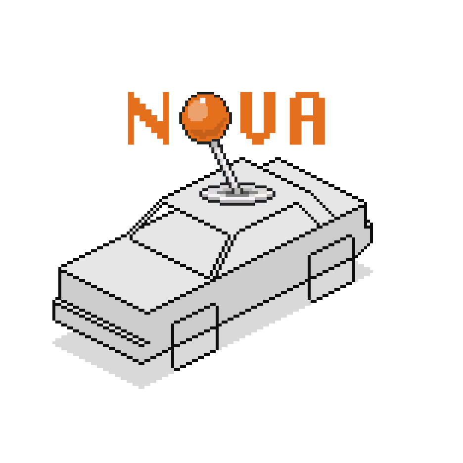
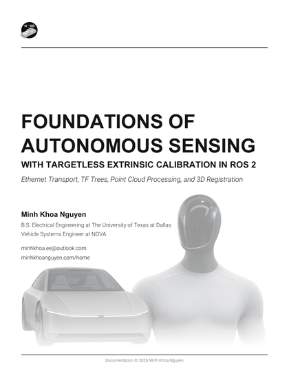

<p align="center">
  
</p>

<h1 align="center">1811 Vehicle Software</h1>

<p align="center">
  ROS 2 software for NOVA UTD’s 1811 research vehicle.
</p>

<p align="center">
  <a href="#quick-start">Quick start</a> ·
  <a href="#how-it-fits-together">How it fits together</a> ·
  <a href="#guides">Guides</a> ·
  <a href="#sensing-guide">Sensing guide</a>
</p>

## Quick start

Use Git and Docker Compose in Ubuntu or [WSL on Windows](docs/vehicle_reference.md#windows-and-wsl). The project’s Docker image includes ROS 2 Humble.

```bash
git clone --recurse-submodules https://github.com/Nova-UTD/1811-fall-2026.git
cd 1811-fall-2026
```

### On your laptop

Start the development container from the repository root.

```bash
mkdir -p -m 700 ~/.ssh  # Create the directory Docker mounts for SSH.
docker compose up -d --build dev
docker compose exec dev bash
```

Inside the container, build the controller and run the bundled route in simulation.

```bash
colcon build --symlink-install --packages-up-to control
source install/setup.bash
ros2 launch control pure_pursuit.launch.py use_sim:=true
```

### On the vehicle

On a fresh Karbon, run `./scripts/vehicle.sh setup-machine` once. Read the [power-up and driving guide](docs/gamepad_controls.md#how-to-run-the-car), then launch from the **Karbon host**.

```bash
./g
```

With a desktop display, `./g` opens the [Vehicle UI Hub](ros2_ws/src/vehicle_ui_hub/README.md) for sensor views, data recording, and camera calibration.

> **Before driving.** Start with simulation for route following. The vehicle can coast when the Arduino loses commands. Follow the driving guide and keep a spotter at the kill switch.

## How it fits together

| Computer | What it runs |
| --- | --- |
| **Karbon 800** | Reads the Ouster LiDAR, estimates where the car is, and sends driving commands to the Arduino. |
| **Jetson Orin** | Runs four ZED X cameras, stitches a 360° view, and aligns camera point clouds with LiDAR. |

The two computers share ROS 2 data over Ethernet. Most project packages are in [`ros2_ws/src/`](ros2_ws/src/).

## Guides

| I want to… | Start here |
| --- | --- |
| Learn how ROS 2 works in this project | [ROS 2 primer](docs/understanding_the_stack.md) |
| Drive, record data, or follow a route | [Gamepad and vehicle controls](docs/gamepad_controls.md) · [Route following](ros2_ws/src/control/README.md) |
| Set up the cameras and network | [Karbon–Jetson setup](docs/camera_link_setup.md) · [Sensor topology](docs/compute_and_sensor_topology.md) |
| Work on camera calibration | [LiDAR–camera registration](ros2_ws/src/lidar_perception/README.md) |
| Flash the Arduino, set up radar, or diagnose a problem | [Vehicle reference](docs/vehicle_reference.md) |

## Sensing guide

<a href="docs/FOUNDATIONS_OF_AUTONOMOUS_SENSING.pdf">
  
</a>

**[Foundations of Autonomous Sensing](docs/FOUNDATIONS_OF_AUTONOMOUS_SENSING.pdf)**<br>
Minh Khoa Nguyen · PDF · 94 pages

Follow 1811’s LiDAR and camera data from sensor capture to a calibrated camera mount in ROS 2.

- **New to sensing?** Start with Chapter 0 for point clouds and coordinate frames. Try the five-minute mount review on printed page iv.
- **Missing or delayed sensor data?** Chapters 1–3 explain Ethernet, timestamps, and ROS 2 coordinate frames (TF). [1811 camera and network checks](docs/camera_link_setup.md#troubleshooting)
- **Working on calibration?** Chapters 4–8 cover point cloud filtering, 3D alignment, and checking a mount in RViz. [1811 calibration code map](ros2_ws/src/lidar_perception/README.md#where-to-debug)
